# Lab 05 – Onboarding an Application with OpenID Connect (OIDC)

<!--
CLIENT CONFIRMATION NEEDED BEFORE PUBLISHING:
- Confirm repository name/visibility and the final lab number used in the portfolio.
- Screenshots are taken from the supplied lab guide (All Things Identity, Lab 5, Authentik 2026.8.5 / Grafana 11.6.0).
  Replace with your own captures if you have them.
- No client secret is shown anywhere in this repository. Keep it that way if you swap in your own screenshots.
-->

<p align="center">
  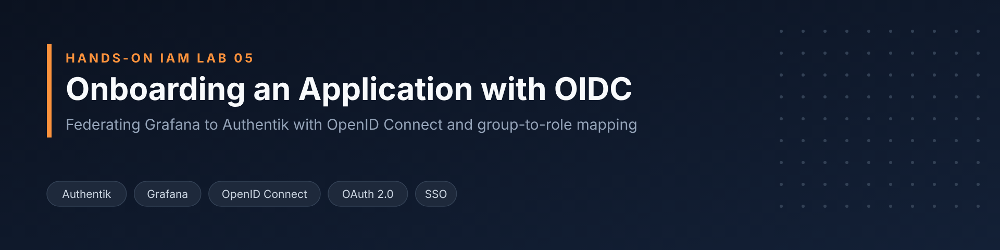
</p>

<p align="center">
  <strong>Professional Lab Documentation | Identity & Access Management / Cybersecurity</strong>
</p>

<p align="center">
  
  
  
  
</p>

---

## 📌 Project Overview

*"Can you get us single sign-on for this new tool?"* is one of the most common requests an IAM engineer receives. This lab completes that request end-to-end: **Grafana** is federated to **Authentik** using **OpenID Connect (OIDC)**, and each user's Grafana role (Admin, Editor or Viewer) is decided by their group membership in the identity provider.

**The problem:** without SSO, every application keeps its own accounts and its own idea of who should have which permissions. Without careful role mapping, SSO users often land with the wrong — frequently excessive — privilege, and nobody notices because nothing errors.

**Why it matters:** OIDC is the protocol most modern applications and cloud platforms ship with. Onboarding an app correctly — exact redirect URI, confidential client, endpoints read from the provider, claim-based role mapping and a safe fallback role — is core, repeatable IAM work.

**Main objective:** onboard Grafana as an OIDC relying party, map IdP groups to application roles through a claim, and prove all three outcomes, including the user nobody planned for.

## 🎯 Objectives

- Explain how the OIDC authorization code flow differs from a SAML assertion exchange
- Create an OAuth2/OpenID Connect provider and application in Authentik
- Read the endpoints an OIDC client needs from the identity provider itself (provider overview and discovery document)
- Configure Grafana to authenticate against Authentik
- Map identity provider groups to Grafana roles using the `groups` claim
- Test Admin, Editor and unmapped (Viewer fallback) outcomes, and verify them in the target system
- Diagnose the redirect URI mismatch — the most common first-attempt OIDC failure

## 🏢 Scenario / Business Context

The organization already uses Authentik as its identity provider and has federated one application (WordPress) using SAML. A new internal tool, **Grafana**, needs single sign-on.

Grafana is an internal dashboard that everyone may *read* but only a few may *edit* or *administer*. The design decision was therefore deliberate:

- **No group binding** on the Grafana application — every directory user may sign in (Layer 1 open by design)
- **Role decided per person** from the `groups` claim (Layer 2): Admins, Editors, everyone else Viewer
- A **low-privilege fallback** for anyone not mapped, and a **break-glass local admin** kept in case the IdP or OIDC configuration fails

## 🛠️ Technologies & Tools

| Technology / Tool | Purpose |
|---|---|
| **Authentik** (2026.8.x) | OpenID provider: OAuth2/OIDC provider, application, groups, scope mappings, token preview |
| **Grafana** (11.6.0) | Relying party / target application using Generic OAuth |
| **OpenID Connect / OAuth 2.0** | Authorization code flow with a confidential client |
| **OpenID Discovery** (`.well-known/openid-configuration`) | Source of the authorize, token and userinfo endpoints |
| **JMESPath role expression** | Grafana *Role attribute path* evaluating the `groups` claim |
| **Explicit-consent authorization flow** | Users see what Grafana will receive before it receives it |

## 🏗️ Architecture / Workflow

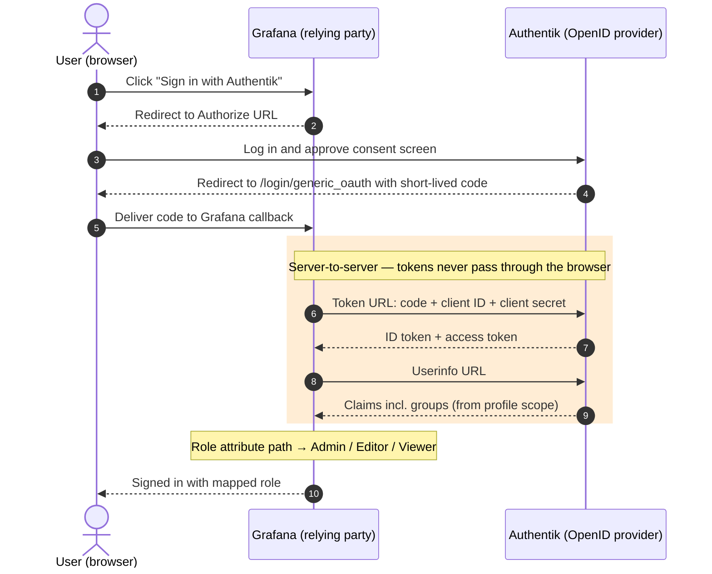

<sub>Static image version: <a href="assets/architecture.png">assets/architecture.png</a></sub>

The user clicks **Sign in with Authentik**, is redirected to Authentik's Authorize URL, logs in and consents. Authentik returns the browser to Grafana's registered redirect URI with a short-lived **code**. Grafana exchanges that code **server-to-server** (with its client ID and secret) for an ID token and userinfo containing a `groups` claim — supplied by the `profile` scope mapping. Grafana's role expression then assigns Admin, Editor or the Viewer fallback.

**Role decision (Layer 2):**

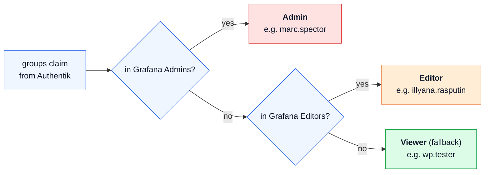

| | SAML 2.0 (previous lab) | OIDC (this lab) |
|---|---|---|
| Format | XML assertion | JSON Web Token |
| App registers | ACS URL and Entity ID | Redirect URI and client ID |
| Trust | IdP's public signing certificate | Client secret held by both sides + IdP public keys (JWKS) |
| Claims arrive in | Assertion attributes | ID token and userinfo |
| Discovery | Metadata XML | `.well-known` JSON document |

**Lab workflow:**

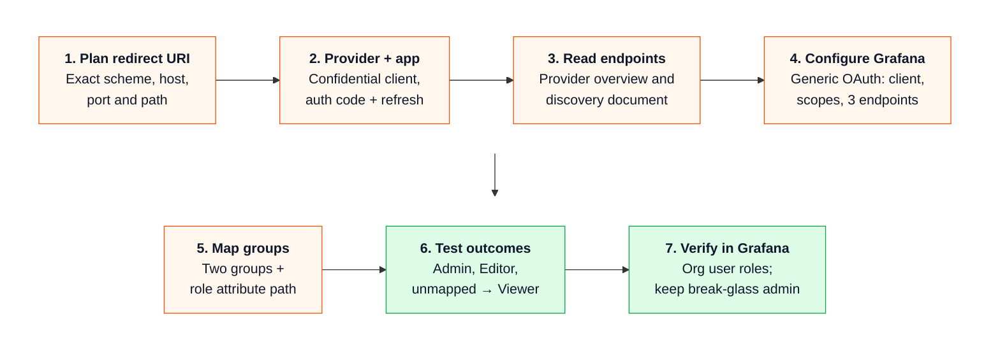

## ⚙️ Implementation / Steps Performed

### Step 1: Create the OIDC Provider and Application in Authentik

The redirect URI was worked out first (`http://<SERVER_IP>:<GRAFANA_PORT>/login/generic_oauth`) because the IdP compares it character-by-character. In **Applications > Providers**, an **OAuth2/OpenID Provider** named `Grafana OIDC` was created with:

- Authorization flow: `default-provider-authorization-explicit-consent`
- Client type: **Confidential** (Grafana runs server-side and can keep a secret)
- Redirect URI registered as a **Strict** entry
- Grant types limited to **Authorization Code** and **Refresh token**
- Scopes: `openid`, `email`, `profile`; signing key: Authentik self-signed certificate

Reading the `profile` scope mapping confirmed that it is the mapping that carries the `groups` claim — there is no separate "groups" scope. The client ID and secret were recorded securely, and an application named **Grafana** was created on the existing provider.

<p align="center">
  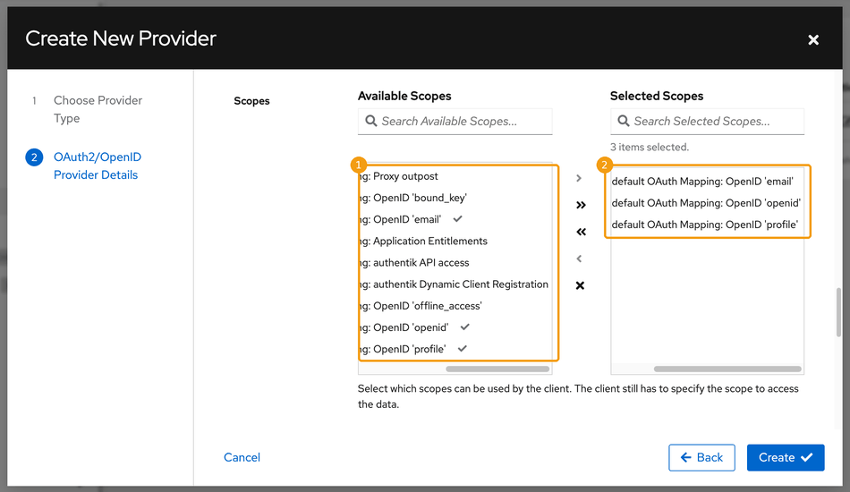
  <br><em>openid, email and profile selected on the provider.</em>
</p>

<p align="center">
  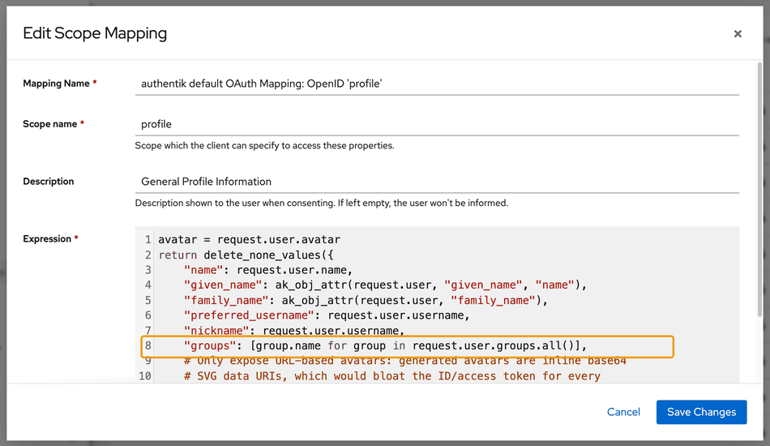
  <br><em>The profile mapping's expression – the highlighted line emits the groups claim.</em>
</p>

<p align="center">
  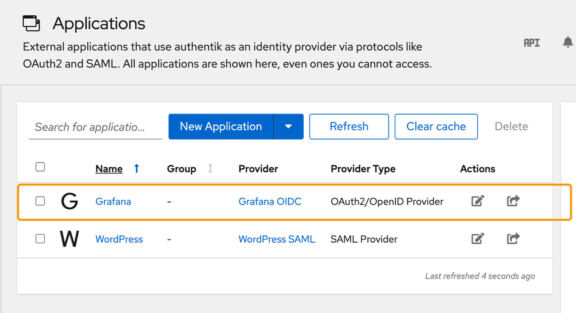
  <br><em>Grafana listed with Grafana OIDC as its provider.</em>
</p>

### Step 2: Read the Endpoints from the Provider

The **Authorize**, **Token** and **Userinfo** URLs were copied from the provider's Overview page, then cross-checked against the **OpenID Configuration URL** (discovery document), where they appear as `authorization_endpoint`, `token_endpoint` and `userinfo_endpoint`. Reading them from the running system avoids errors from version-specific paths and the easily missed trailing slash.

<p align="center">
  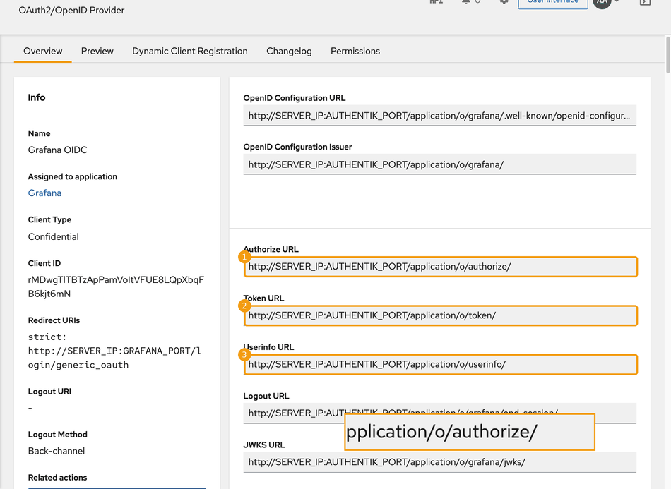
  <br><em>Endpoints read directly from the provider overview.</em>
</p>

<p align="center">
  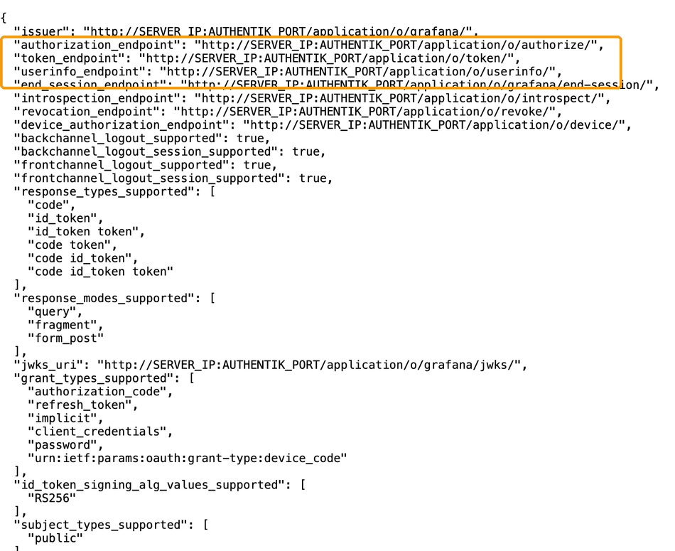
  <br><em>The discovery document confirms the same endpoints.</em>
</p>

### Step 3: Configure Grafana's Generic OAuth

Logged in with Grafana's local admin, **Administration > Authentication > Generic OAuth** was configured with the display name `Authentik`, the client ID and secret, scopes `openid email profile`, the three endpoints, and **Allow sign up** enabled. The setting was saved with **Save and enable**, and a private window confirmed the new **Sign in with Authentik** button.

<p align="center">
  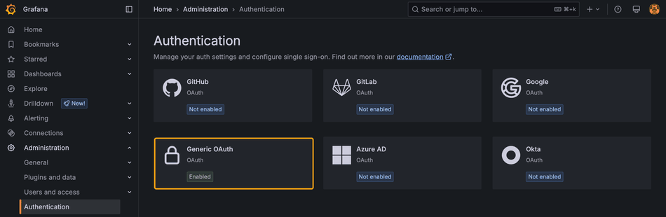
  <br><em>The Generic OAuth tile reads Enabled.</em>
</p>

<p align="center">
  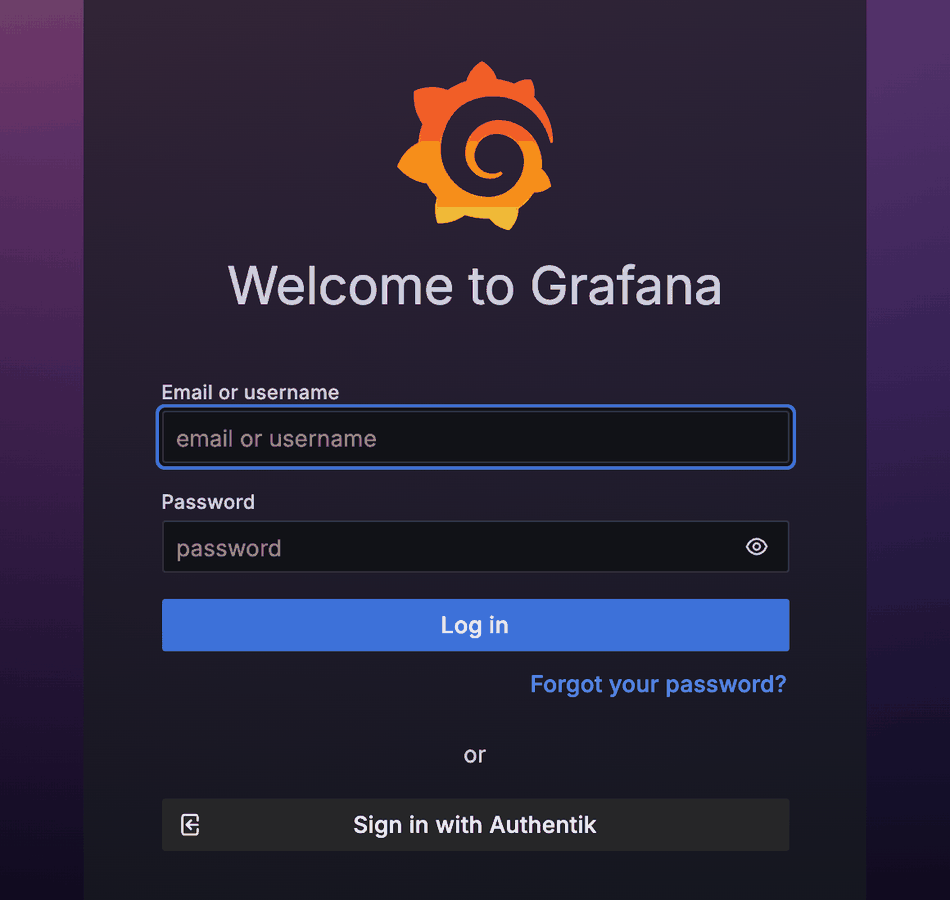
  <br><em>Grafana's login page now offers Sign in with Authentik.</em>
</p>

### Step 4: Map Groups to Grafana Roles

Two groups were created in Authentik — **Grafana Admins** (Marc Spector) and **Grafana Editors** (Illyana Rasputin) — while a third user (WP Tester) was deliberately left in neither group. In Grafana's **User mapping > Role attribute path**, the default value was replaced with:

```text
contains(groups[*], 'Grafana Admins') && 'Admin' || contains(groups[*], 'Grafana Editors') && 'Editor' || 'Viewer'
```

The expression is evaluated left-to-right and stops at the first match; the final `'Viewer'` is the fallback. Strict mode was left off because the expression always returns a valid role.

<p align="center">
  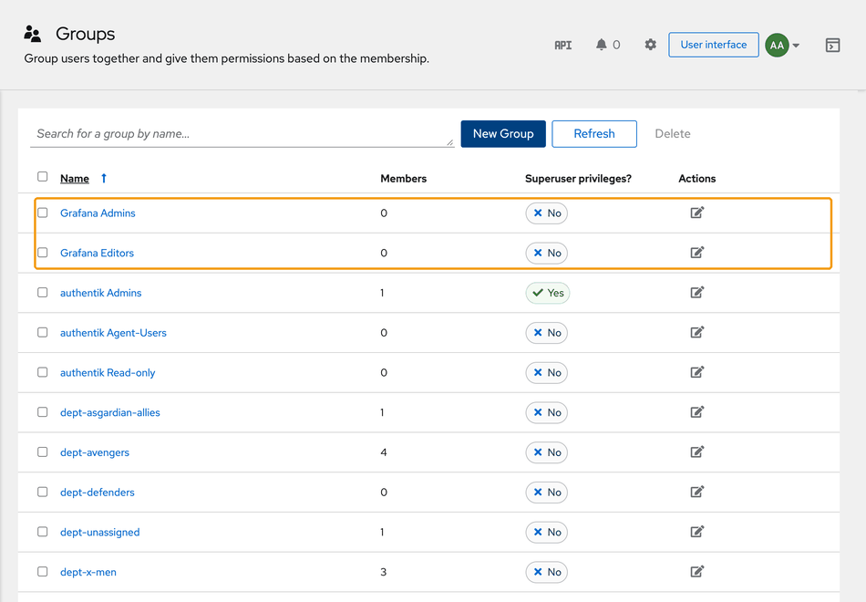
  <br><em>Grafana Admins and Grafana Editors created in Authentik.</em>
</p>

<p align="center">
  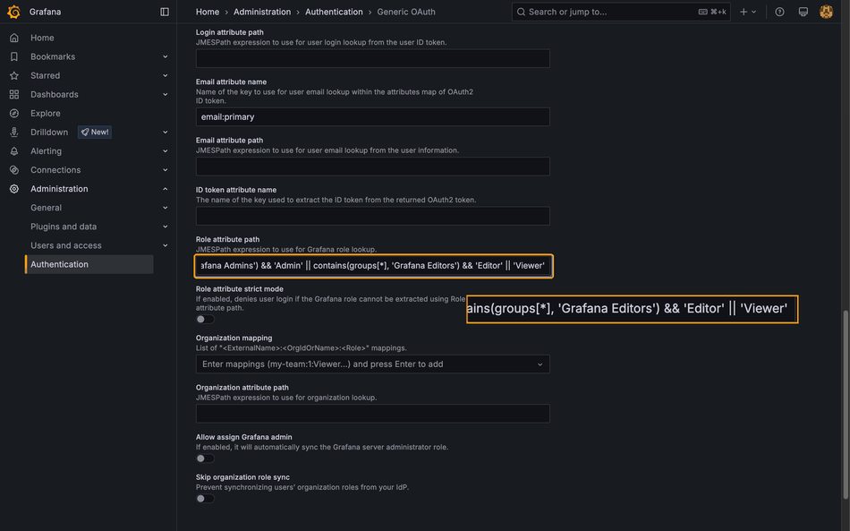
  <br><em>Role attribute path holds the group-to-role expression.</em>
</p>

### Step 5: Test All Three Outcomes

Each user signed in from a fresh private window (signing out of Grafana does not end the Authentik session):

| Test user | Authentik group | Expected | Result |
|---|---|---|---|
| Marc Spector | Grafana Admins | Admin | Admin – full Administration menu |
| Illyana Rasputin | Grafana Editors | Editor | Editor – can create dashboards; Administration limited to *Plugins and data* |
| WP Tester | *(none)* | Viewer | Viewer – signed in, no edit rights |

<p align="center">
  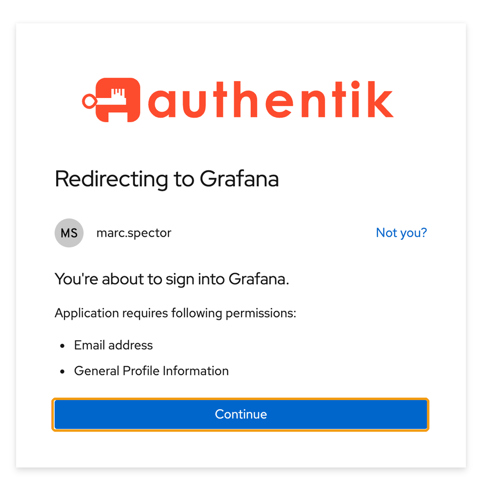
  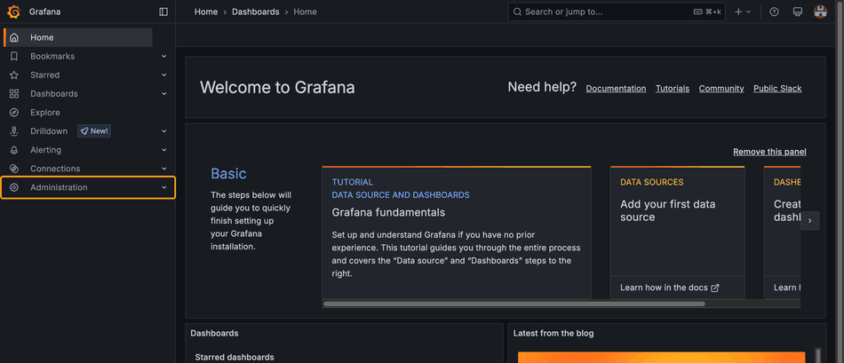
  <br><em>Explicit consent, then the Admin lands in Grafana with the Administration menu.</em>
</p>

<p align="center">
  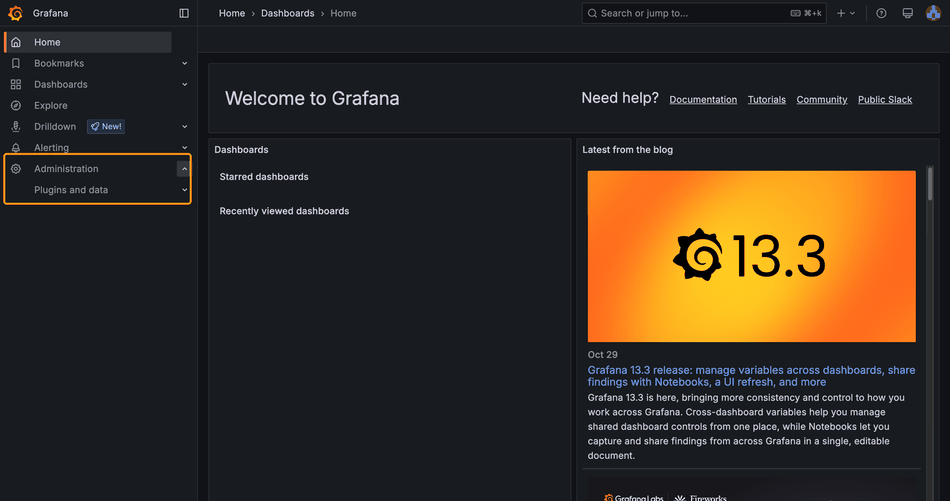
  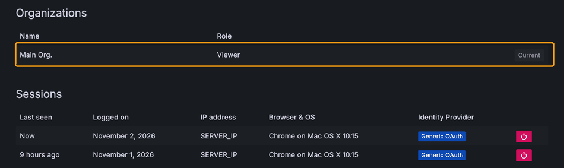
  <br><em>The Editor sees only Plugins and data under Administration; the unmapped user lands as Viewer.</em>
</p>

### Step 6: Verify in the Target System

Signing in with the local admin (not through Authentik), **Administration > Users and access > Users > Organization users** confirmed four accounts: the local admin plus three SSO users holding **Admin**, **Editor** and **Viewer** respectively. The local admin was kept as a **break-glass** account.

<p align="center">
  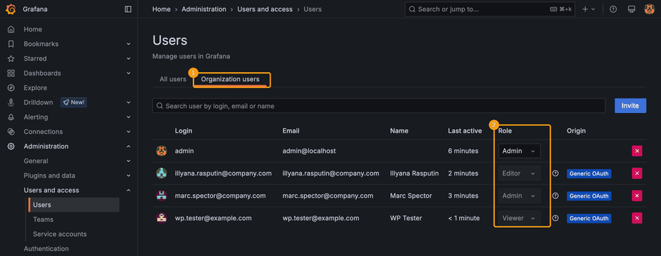
  <br><em>Each SSO user holds the role their Authentik group maps to.</em>
</p>

## 🔍 Key Findings / Results

- **Working OIDC SSO** between Grafana and Authentik using the authorization code flow with a confidential client.
- **Claim-based authorization works in both directions:** mapped users received Admin and Editor; the unmapped user received Viewer — not Admin and not refused.
- **The fallback role is the critical setting.** If the `groups` claim is missing, every user silently lands on the fallback, so it must be low-privilege and never set to Admin "for testing".
- **Endpoints and claims were verified, not assumed** — via the discovery document and the provider's token **Preview** tab, which showed the `groups` claim.
- **Open-by-design access (Layer 1) was a recorded decision**, unlike the gated WordPress app in Lab 04; an application with no bindings is still documented as a finding for inventory.
- **Single point of failure acknowledged:** a break-glass local admin was retained.
- **Organization Admin ≠ server admin:** the mapping assigns Grafana's organization Admin role; the server-level GrafanaAdmin role was never granted.

<p align="center">
  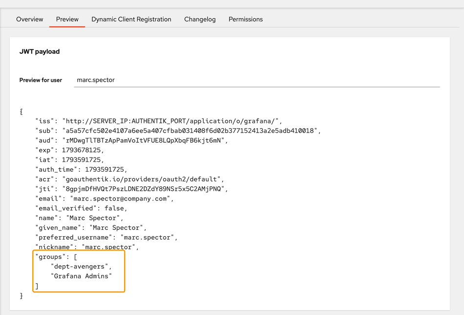
  <br><em>Authentik's token Preview shows the groups claim Grafana reads.</em>
</p>

## 🧠 Skills Demonstrated

- OIDC / OAuth 2.0 application onboarding (authorization code flow, confidential clients)
- SAML vs. OIDC protocol comparison
- Identity provider configuration (Authentik providers, applications, scope mappings)
- Service-provider configuration (Grafana Generic OAuth)
- Claim-based, group-to-role authorization with JMESPath
- Least-privilege fallback design and negative/edge-case testing
- Federation troubleshooting (redirect URI mismatch, client ID errors, missing claims)
- Break-glass account practice and resilience planning

## 📸 Screenshots & Evidence

<p align="center">
  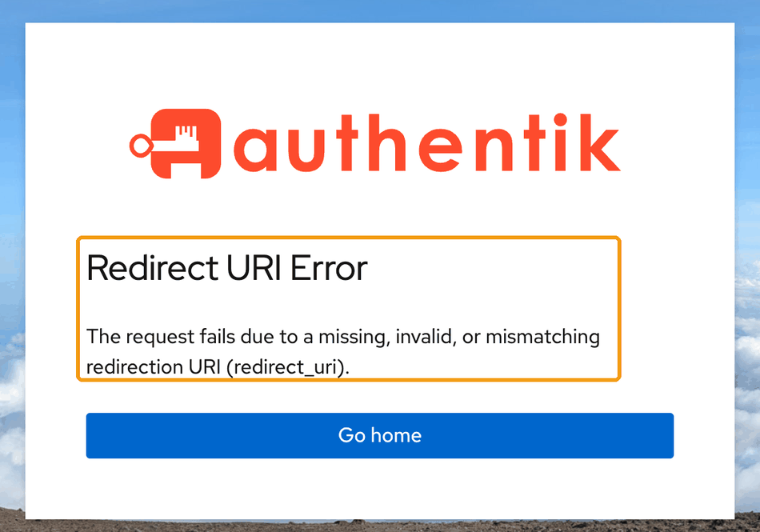
  <br><em>Reference: the Redirect URI Error Authentik returns when the requested redirect URI is not registered exactly – the most common first-attempt failure.</em>
</p>

| Evidence | What it shows |
|---|---|
| [Provider scopes](assets/screenshots/step-01-provider-scopes.png) | `openid`, `email`, `profile` selected |
| [Discovery document](assets/screenshots/step-02-discovery-document.png) | Endpoints published by the provider |
| [Role expression](assets/screenshots/step-04-role-attribute-path.png) | Group-to-role mapping in Grafana |
| [Organization users](assets/screenshots/step-06-org-user-roles.png) | Admin / Editor / Viewer verified |
| [Token preview](assets/screenshots/evidence-token-preview-groups.png) | `groups` claim present in the token |

## 💼 Real-World Relevance

- **Enterprise SSO:** the same steps — redirect URI, client credentials, endpoints, claims, role mapping — apply to onboarding apps in Entra ID, Okta, Ping or Keycloak.
- **IT operations:** a repeatable onboarding checklist plus a troubleshooting table reduces failed go-lives and support tickets.
- **Identity and access management:** mapping roles from IdP groups (or app-scoped entitlements) centralizes authorization decisions in the identity provider.
- **Cybersecurity:** limiting grant types, using a confidential client, protecting the client secret and enforcing a low-privilege fallback reduce over-privilege and attack surface.
- **Compliance and audit:** role assignment is expressed as a rule that can later be reviewed and certified.

## 📝 Summary

This lab onboarded Grafana to Authentik with OpenID Connect, completing the full application-onboarding pattern on a second protocol. Grafana authenticates through a confidential OIDC client, receives the user's groups in a claim, and assigns Admin, Editor or a safe Viewer fallback — all verified in the target system, with a break-glass account retained. Together with the SAML lab, it shows the transferable skill: the protocol details change, but the questions stay the same — who is this, what may they do, and what happens to the person nobody planned for.

## ⚠️ Disclaimer

This project is documented for educational and portfolio purposes. It was performed in a personal lab environment, not in production. The lab ran over HTTP for simplicity; production OIDC deployments must use HTTPS. Screenshots and scenario details are based on the supplied lab materials (*All Things Identity – Hands-On IAM Labs, Lab 5*). Names shown are fictional test identities, and no client secrets are included.

---

<p align="center">
  <strong>Created as part of a professional cybersecurity and IAM portfolio.</strong>
</p>
